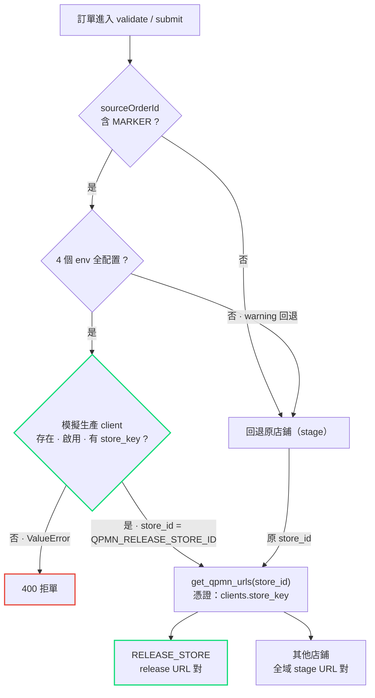

# QPMN 生產分流（Release Routing）流程

> 適用場景：stage 環境測試時，`sourceOrderId` 帶特定字符（marker）的訂單直接走 QPMN release 平台的真實生產流程；其餘訂單照常走 stage 平台。

## 決策流程圖

## 三層判斷邏輯

入口（[orders.py](../app/api/orders.py) 的 validate 與 submit）調用
`client_service.resolve_release_routing(source_order_id)`（[client.py](../app/services/client.py)）：

| # | 判斷 | 條件 | 未通過時的行為 |
|---|------|------|----------------|
| 1 | MARKER 命中 | `QPMN_RELEASE_ORDER_MARKER` 已設置，且 `sourceOrderId` 非空並包含 marker | 返回 `None` → 走原店鋪 |
| 2 | 配置完整 | `MARKER` / `STORE_ID` / `API_URL` / `OPEN_API_URL` 四個環境變量全部設置 | 記 warning 後返回 `None` → **自動回退原店鋪**（不拒單） |
| 3 | client 有效 | `QPMN_RELEASE_STORE_ID` 對應的 client 行存在、已啟用、有 `store_key` | 拋 `ValueError` → 入口返回 **400 拒單** |

命中後僅做一件事：`store_id = QPMN_RELEASE_STORE_ID`。後續全鏈路自動跟隨，無需每處單獨判斷平台。

## 分流結果對照

| | 未命中 / 未配置 | 命中 MARKER |
|---|---|---|
| **store_id** | 原店鋪 store_id | `QPMN_RELEASE_STORE_ID` |
| **API URL** | `QPMN_API_URL` | `QPMN_RELEASE_API_URL` |
| **Open API URL** | `QPMN_OPEN_API_URL` | `QPMN_RELEASE_OPEN_API_URL` |
| **認證憑證** | 原 client 的 `store_key` | 模擬生產 client 的 `store_key` |

URL 與憑證解析統一經 `client_service.get_qpmn_urls(store_id)`：release store 返回 release URL 對，其他返回全域 URL 對。

## 按 store_id 自動跟隨的調用鏈

- 設計文件上傳（publish / brand label / packing slip）
- push 訂單（Open API）
- 產品與 SKU 同步
- 樣品數據（sampleData）
- 轉售價（resalePrice）
- 訂單取消 / 退貨
- 收貨地址（deliveryAddress）
- 配送方式（shippingMethod）
- 幣種查詢
- Webhook 管理（QPMN §4 註冊 / 查詢 / 更新 / 刪除）

## 相關配置

| 環境變量 | 說明 |
|---|---|
| `QPMN_RELEASE_ORDER_MARKER` | 訂單路由標記（如 `-REL`），命中即分流 |
| `QPMN_RELEASE_STORE_ID` | 模擬生產 client 的 store_id |
| `QPMN_RELEASE_API_URL` | release 平台 API base URL |
| `QPMN_RELEASE_OPEN_API_URL` | release 平台 Open API base URL |

> 任一變量未設置（或 marker 未命中）時，分流功能視為關閉，訂單自動走原店鋪，不會因配置缺失而拒單。
